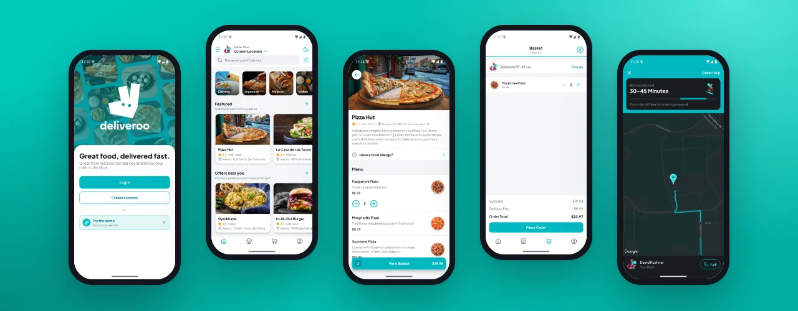
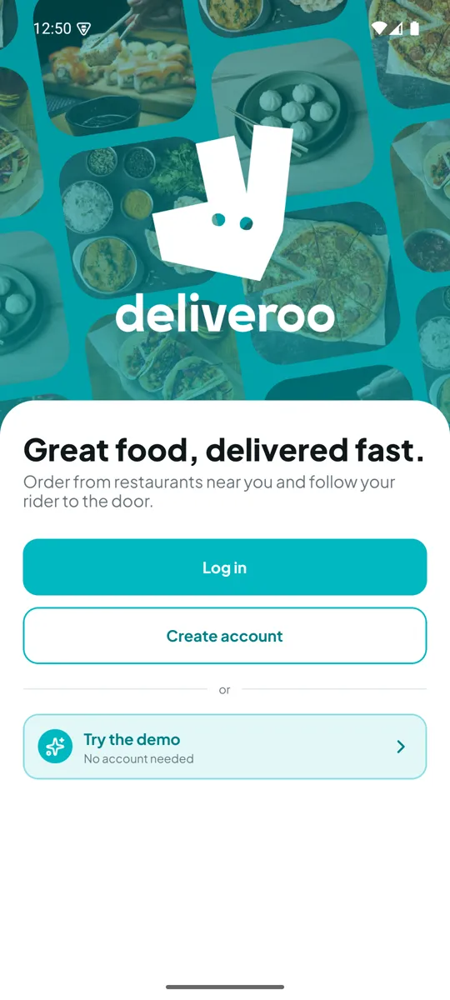
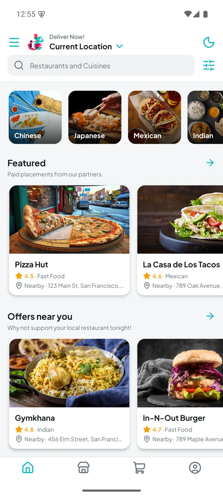
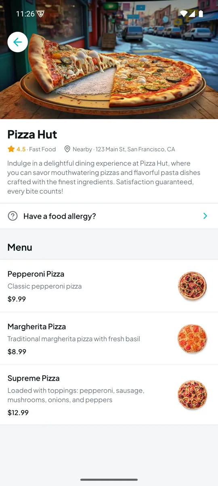
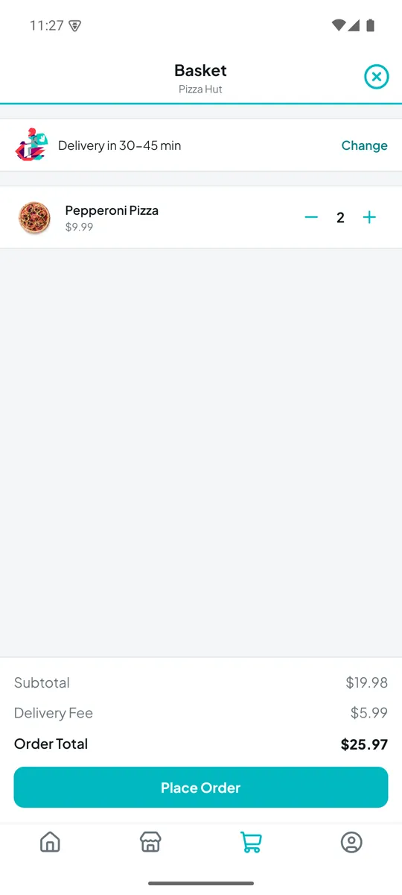
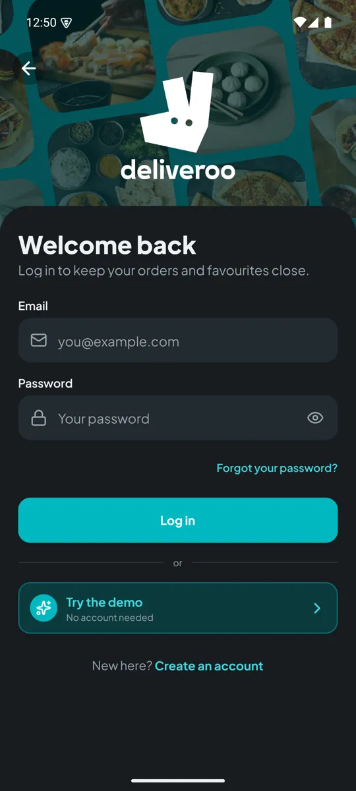
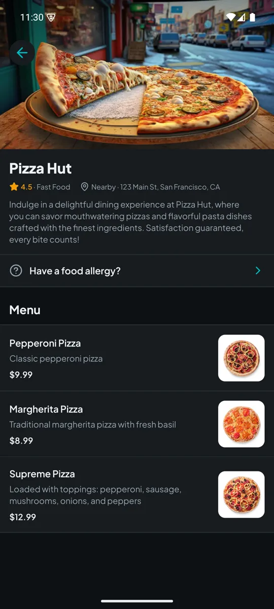
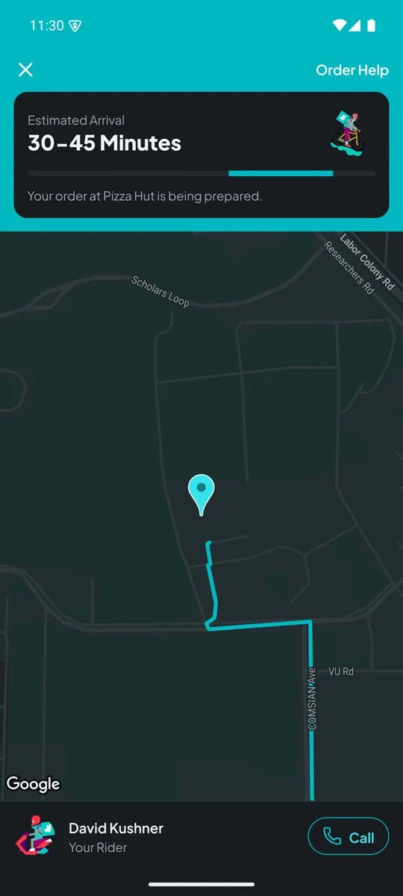
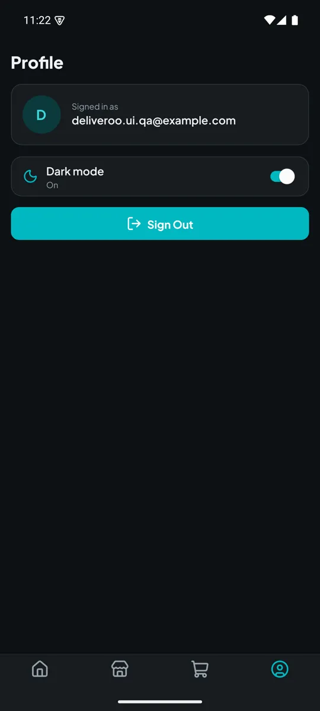

# Deliveroo App

Deliveroo clone built with React Native (Expo SDK 58), React Navigation, Redux Toolkit, NativeWind (Tailwind CSS) and React Native Firebase.

## Installation

To install the Deliveroo app on an Android device:

- Download the latest APK (`deliveroo-v<version>.apk`) from [GitHub Releases](https://github.com/MaizNadeem/Deliveroo-2.0/releases). Every release also ships a `.sha256` file to verify the download.
- Open the APK on your device and, if prompted, allow installation from unknown sources.
- Follow the on-screen instructions, then open the app.

This installation method is for Android only.

## About the Project

The "Deliveroo" app is a food delivery demo. It has these screens:

- **Start, Login, Register and Reset Password:** account creation and sign-in with email and password, or **Try the demo** without an account.
- **Dashboard:** browse categories and featured restaurants.
- **Restaurant:** restaurant details and menu, add dishes to the basket.
- **Basket:** review and edit the order.
- **Preparing Order and Delivery:** order confirmation animation, then a map with the restaurant, your location and the route.
- **Profile:** the signed-in account, the light/dark mode switch and sign out.

## Screenshots

Light mode

<p align="center">
  
  
  
  
</p>

Dark mode

<p align="center">
  
  
  
  
</p>

## Technologies


### App
- **React Native 0.88 / Expo SDK 58** (New Architecture), plain JavaScript, npm.
- **React Navigation 7:** a root stack containing a drawer, which contains bottom tabs.
- **Redux Toolkit:** basket and selected restaurant state.
- **NativeWind 4 (Tailwind CSS 3):** `className` styling with a semantic light/dark palette (`core/palette.js`, `tailwind.config.js`).
- **Light and dark mode:** follows the system until the user taps the sun/moon toggle (Dashboard header or Profile); the choice is saved with AsyncStorage.
- **Plus Jakarta Sans** (embedded at build time) and **Lucide** icons.
- **expo-video:** the order-preparing animation.

### Firebase (React Native Firebase, modular API)
- **Authentication:** email and password sign-in and registration, plus a one-tap **Try the demo** button (Firebase anonymous sign-in, so no shared credentials ship in the app; signing out deletes the demo user).
- **Firestore:** read-only. The `Restaurant`, `Dish`, `Categories` and `Featured` collections hold the data.
- **Cloud Storage:** catalogue images (WebP) in the default `PROJECT_ID.firebasestorage.app` bucket under `restaurants/`, `categories/` and `dishes/`. Objects have no public download tokens; `components/StorageImage.js` fetches them with the user's ID token and App Check token.
- **App Check:** Play Integrity in release builds (configured for APKs distributed outside Google Play), a debug provider in development builds.

The app talks only to Firebase and Google Maps; it has no backend of its own. (The unused `graphql` Cloud Function left over from the original 2023 project was removed in November 2026.) Firestore and Storage only serve signed-in users and never accept client writes ([`firestore.rules`](firestore.rules), [`storage.rules`](storage.rules); deploy changes with the Firebase console or CLI). With App Check enforced, only genuine installs of the app get through.

Cloud Storage and Google Maps need the Firebase project on the Blaze plan. The project is kept at $0: map loads on Android are free, Routes API calls are capped below the free monthly tier, unused Maps APIs are disabled, every key is restricted to the app's package and signing certificate, and a $1 budget alerts on any spend.

### Google Maps
- **Maps SDK for Android** (react-native-maps) for the delivery map.
- **Routes API** (`routes.googleapis.com/directions/v2:computeRoutes`) for the route line. If the request fails, the app draws a straight line between the two points.
- Builds made without `GOOGLE_MAPS_ANDROID_API_KEY` show a placeholder instead of the map (the Maps SDK would otherwise crash the app).

## Getting Started

React Native Firebase is native code, so **Expo Go does not work**. Use a development build.

### Prerequisites

- Node.js 22.13+ or 24.3+ (24 tested) and npm
- JDK 17 (`JAVA_HOME` pointing to it)
- Android SDK (Android Studio), with an emulator or a USB-debugging device
- On Windows: SDK CMake 3.31 or newer (`sdkmanager "cmake;3.31.6"`). Older CMake ships a ninja that fails on long paths; the release script picks the newest installed CMake automatically.
- A Firebase project with an Android app whose package name is `com.himaiz.deliveroo`, Email/Password sign-in enabled and Firestore data

### Files and environment variables

| Name | Purpose |
| --- | --- |
| `google-services.json` (repo root, git-ignored) | Firebase Android config from the Firebase console. Override the location with `GOOGLE_SERVICES_JSON`. |
| `GoogleService-Info.plist` (repo root, git-ignored) | Firebase iOS config. Only needed for iOS builds. Override with `GOOGLE_SERVICE_INFO_PLIST`. |
| `GOOGLE_MAPS_ANDROID_API_KEY` | Android-restricted Google Maps key (Maps SDK for Android and Routes API enabled). Written into the manifest at prebuild and read at runtime. |
| `ANDROID_CERT_SHA1` | SHA-1 of the signing certificate the Maps key is restricted to, without colons, uppercase. Sent as `X-Android-Cert` to the Routes API. |
| `EXPO_PUBLIC_APPCHECK_DEBUG_TOKEN` | App Check debug token for development builds. Register it in Firebase console > App Check. Without it, run `adb logcat \| grep DebugAppCheckProvider` to read a generated one. |
| `DELIVEROO_KEYSTORE_PATH`, `DELIVEROO_KEYSTORE_PASSWORD`, `DELIVEROO_KEY_ALIAS`, `DELIVEROO_KEY_PASSWORD` | Release signing keystore (absolute path). Required for release builds only. |

`.env.example` lists all of them. The android and ios folders are generated by `expo prebuild` and are not committed.

The Maps key and certificate hash are embedded in the app (manifest and app config); that is normal for Maps keys, so restrict the key to the app's package name and signing certificate in Google Cloud.

### Run locally

```bash
git clone https://github.com/MaizNadeem/Deliveroo-2.0.git
cd Deliveroo-2.0
npm install
# put google-services.json in the repo root, then:
npx expo run:android
```

`npx expo run:android` runs prebuild, builds and installs the debug build, and starts Metro. After the first build, `npx expo start --dev-client` is enough for JavaScript changes. Re-run `npx expo run:android` after changing dependencies, plugins or `app.config.js`.

## Versioning

The version lives only in `package.json` (`version`). `app.config.js` derives the rest:

- app version (`versionName`) = `package.json` version
- `android.versionCode` = `major * 10000 + minor * 100 + patch` (2.0.0 is 20000, 2.13.4 is 21304)

Minor and patch must stay below 100; the config throws otherwise. Never edit `versionCode` by hand.

## Releasing (Android)

Releases are built locally and published to GitHub Releases with one script:

```bash
npm run release:android -- <version> [--publish] [--rebuild]
```

Run it on `main`. `package.json` already says 2.0.0, so the first release is `npm run release:android -- 2.0.0 --rebuild`; later ones pass the next version (for example `2.0.1`).

Requirements: a clean git tree, JDK 17, the signing environment variables, `google-services.json`, and (for `--publish`) an authenticated GitHub CLI (`gh auth login`).

The script:

1. checks the version is valid MAJOR.MINOR.PATCH and greater than `package.json`'s (`--rebuild` allows the same version if its tag does not exist yet);
2. runs `npm version <version> --no-git-tag-version`;
3. runs `npx expo prebuild --platform android --clean --no-install` (the local plugin `plugins/withAndroidReleaseSigning.js` adds the release signing config; the Gradle build fails with a clear message if the signing variables are missing, and never falls back to the debug keystore);
4. runs `gradlew assembleRelease` in `android/`;
5. copies the APK to `dist/deliveroo-v<version>.apk`, writes `dist/deliveroo-v<version>.apk.sha256` and prints path, size, versionName and versionCode;
6. creates a local commit "Release v<version>" (`package.json` and `package-lock.json`) and an annotated tag `v<version>`.

Nothing leaves your machine unless you pass `--publish`, which also runs `git push origin HEAD --follow-tags` and `gh release create v<version> ... --generate-notes`. Without it the script prints those two commands.

**APK size:** release builds contain only `arm64-v8a` and `armeabi-v7a` (set through `expo-build-properties` `buildArchs` in `app.config.js`), which is about half the size of a four-ABI build. Set `DELIVEROO_ANDROID_ABIS` (comma-separated, or `all`) at prebuild time to change it; `npx expo run:android` always builds for the connected device or emulator.

**QA builds (never published):** a release-mode build cannot pass Play Integrity on an emulator. For startup measurements, build with `EXPO_PUBLIC_DELIVEROO_QA_APPCHECK_DEBUG=1` and `EXPO_PUBLIC_APPCHECK_DEBUG_TOKEN=<registered debug token>`, which switches `firebase/appCheck.js` to the debug provider, and pass `-PdeliverooQa=true` to Gradle. The release script and the Gradle release guard refuse to run while either variable is set, and the release JS bundle is always rebuilt, so a QA bundle can't be reused by a release. Keep QA APKs out of `dist/`.

## Contact

Maiz - contact.maiznadeem@gmail.com

Project Link: [https://github.com/MaizNadeem/Deliveroo-2.0.git](https://github.com/MaizNadeem/Deliveroo-2.0.git)

---
